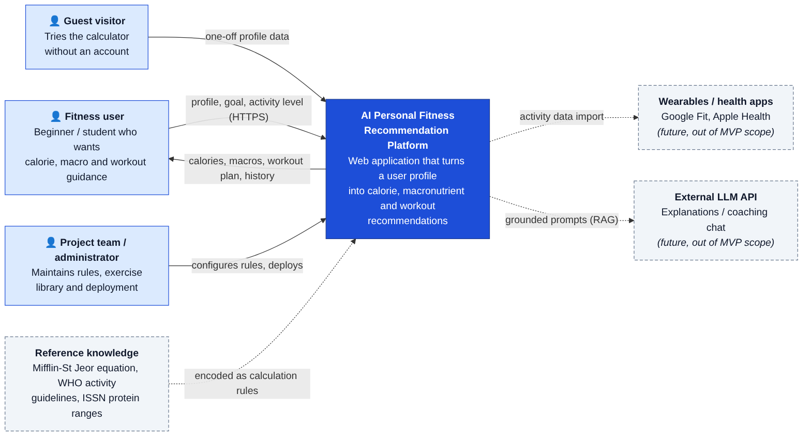
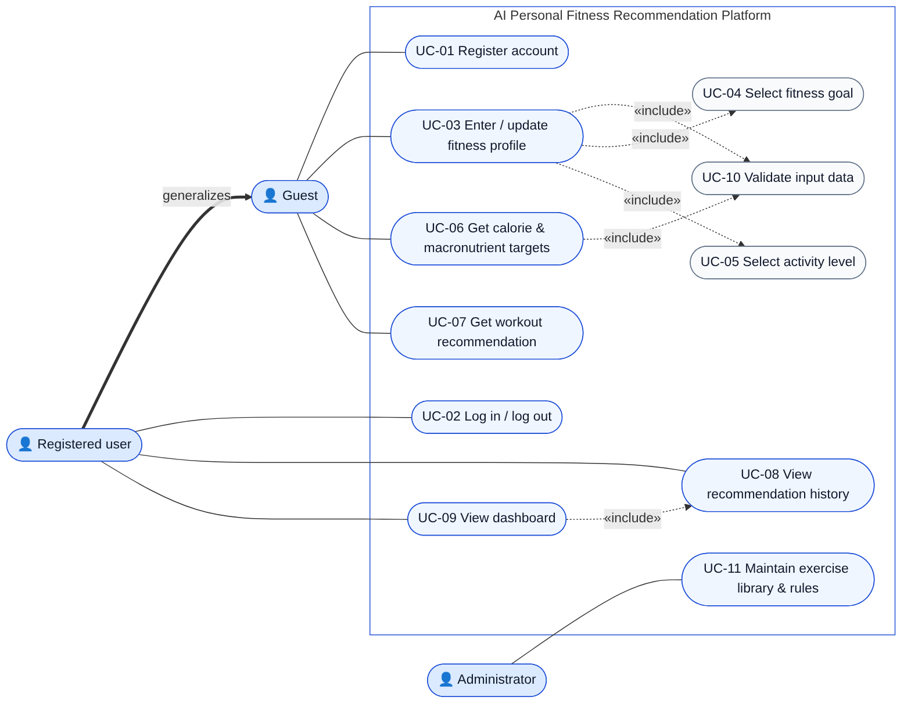
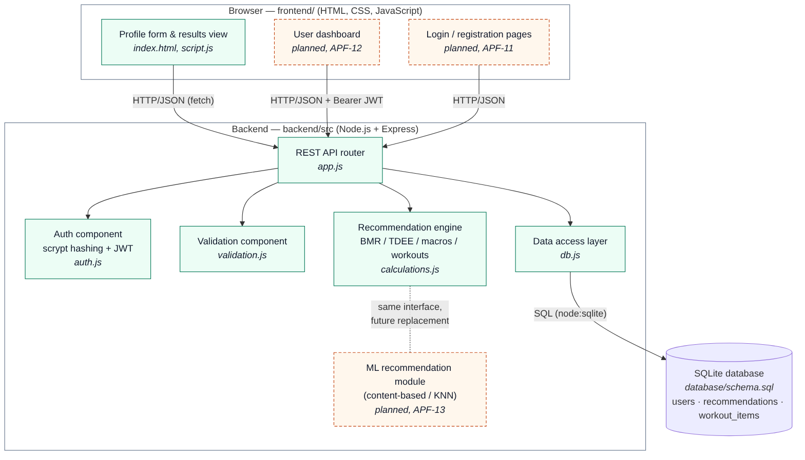
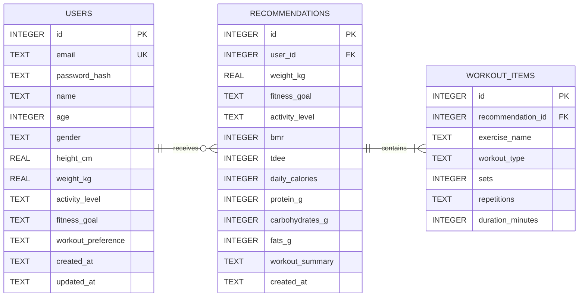
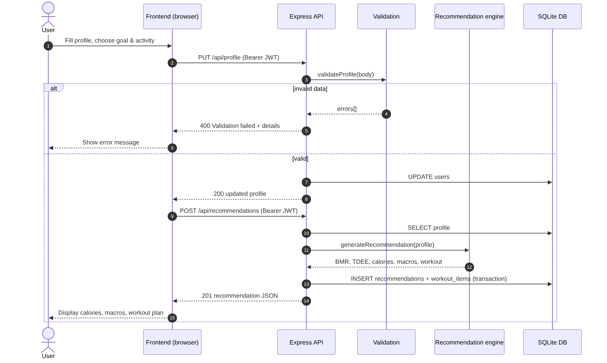

# 7. Architecture and Diagrams

All diagrams are kept as **editable Mermaid sources** in [`architecture/source/`](architecture/source/) and as exported PNG files in [`architecture/`](architecture/). To edit one, open the `.mmd` file in https://mermaid.live or any Mermaid plugin (VS Code, GitHub renders them natively), then re-export it:

```bash
npx -p @mermaid-js/mermaid-cli mmdc -i docs/architecture/source/<name>.mmd -o docs/architecture/<name>.png -b white -s 2
```

## 7.1 Architectural style

The system uses a **three-tier client–server architecture** with a stateless REST API:

1. **Presentation tier.** A static HTML/CSS/JS frontend running in the browser.
2. **Application tier.** A Node.js + Express backend made of separate modules: routing, validation, authentication, recommendation engine and data access.
3. **Data tier.** A relational database (SQLite in the MVP, with standard SQL portable to PostgreSQL).

**Key design decisions** (justified in [05-technology-comparison.md](05-technology-comparison.md)):

- The **recommendation engine is a pure module** with one entry point, `generateRecommendation(profile)`. The planned ML model (APF-13) implements the same interface, so it can replace or be compared with the rule-based baseline without changes to the API or the UI.
- **Stateless authentication** with JWT keeps the API horizontally scalable and easy to test.
- The **API factory pattern** (`createApp({ db, jwtSecret })`) allows each test to inject an in-memory database.
- The backend also **serves the frontend**, so a single process runs the full application and the frontend can call the API by relative URL. This removed a previously hard-coded Codespaces URL.

## 7.2 System context diagram



*Source:* [`context-diagram.mmd`](architecture/source/context-diagram.mmd)

| External entity | Interaction | In MVP? |
|---|---|---|
| Fitness user (registered) | Sends profile, goal and activity level; receives targets, plan and history | Yes |
| Guest visitor | One-off calculation, nothing stored | Yes |
| Project team / administrator | Maintains rules and exercise library; deploys | Yes (via code/config) |
| Reference knowledge (Mifflin-St Jeor, WHO, ISSN) | Encoded as calculation rules [13–15] | Yes |
| Wearables / health apps | Activity data import | No (future, FR-17) |
| External LLM API | RAG-grounded explanations | No (future, FR-18) |

## 7.3 Use case diagram



*Source:* [`use-case-diagram.mmd`](architecture/source/use-case-diagram.mmd). The use cases are described in [06-requirements.md §6.3](06-requirements.md). A *Registered user* can do everything a *Guest* can (actor generalisation), and in addition can log in, view history and use the dashboard.

## 7.4 Component diagram (draft)



*Source:* [`component-diagram.mmd`](architecture/source/component-diagram.mmd). Green components are implemented; orange dashed components are planned.

| Component | File | Responsibility | Owner |
|---|---|---|---|
| Profile form & results view | `frontend/index.html`, `script.js` | Collect input, call API, render results and errors | Arman |
| User dashboard, login pages | planned | Profile summary, targets, history (FR-11) | Arman |
| REST API router | `backend/src/app.js` | Endpoints, HTTP status codes, error handling | Bakhytzhan |
| Auth component | `backend/src/auth.js` | scrypt hashing, JWT issue/verify, `requireAuth` middleware | Bakhytzhan |
| Validation component | `backend/src/validation.js` | Ranges, enums, error messages (FR-05) | Bakhytzhan |
| Recommendation engine | `backend/src/calculations.js` | BMR, TDEE, calorie target, macros, workout plan | Abzal |
| Data access layer | `backend/src/db.js` | Schema loading, prepared statements, transactions | Bakhytzhan |
| ML recommendation module | planned (`ml/`) | KNN profile classifier trained offline, same interface | Abzal |
| Database | `database/schema.sql` | `users`, `recommendations`, `workout_items` | Bakhytzhan |

## 7.5 Data model



*Source:* [`er-diagram.mmd`](architecture/source/er-diagram.mmd), implemented in [`database/schema.sql`](../database/schema.sql).

- `users`: account and profile data in one row (1:1). CHECK constraints enforce the same ranges as the API validation, so the database is a second line of defence (NFR-06, NFR-08).
- `recommendations`: one row per generated recommendation. It stores a **snapshot** of the inputs (weight, goal, activity) and of the outputs, so the history stays correct after the profile changes.
- `workout_items`: the exercises of a recommendation (1:N), saved in the same transaction as the recommendation.
- Deleting a user cascades to that user's recommendations and items (prepares FR-16).

## 7.6 Main scenario: sequence diagram



*Source:* [`sequence-recommendation.mmd`](architecture/source/sequence-recommendation.mmd)

## 7.7 REST API

| Method & path | Auth | Purpose | Success | Errors | FR |
|---|---|---|---|---|---|
| `GET /api/health` | — | Service status | 200 | — | NFR-09 |
| `POST /api/auth/register` | — | Create account `{email, password, name}` | 201 `{token, user}` | 400, 409 | FR-01 |
| `POST /api/auth/login` | — | Log in `{email, password}` | 200 `{token, user}` | 400, 401 | FR-02 |
| `GET /api/profile` | Bearer | Read own profile | 200 | 401, 404 | FR-03 |
| `PUT /api/profile` | Bearer | Update profile `{name, age, gender, height, weight, goal, activity, workoutPreference}` | 200 | 400, 401 | FR-03 to FR-05 |
| `POST /api/recommendation` | — | Guest calculation from a profile in the body | 200 | 400 | FR-06 to FR-09, FR-12 |
| `POST /api/recommendations` | Bearer | Generate from stored profile and save to history | 201 | 401, 422 (incomplete profile) | FR-06 to FR-10 |
| `GET /api/recommendations?limit=20` | Bearer | History, newest first, with exercises | 200 | 401 | FR-10 |

All errors have the same JSON shape: `{"error": "<message>", "details": ["<field message>", ...]}`.

## 7.8 Recommendation logic (baseline engine)

```
BMR      = 10·weight + 6.25·height − 5·age + 5      (male)
                                          − 161     (female)          [Mifflin-St Jeor, 13]
TDEE     = BMR × {low 1.2, moderate 1.55, high 1.725}
Calories = max(TDEE × {loss 0.85, maintenance 1.00, gain 1.10}, floor{male 1500, female 1200})
Protein  = weight × {loss 1.8, maintenance 1.4, gain 1.8} g          [ISSN range 1.4–2.0, 15]
Fat      = 25 % of calories / 9 kcal·g⁻¹
Carbs    = (calories − 4·protein − 9·fat) / 4
Workout  = template[goal] with sessions/week = {low 3, moderate 4, high 5}       [WHO 2020, 14]
```

**Planned ML component (APF-13).** Following Lee & Jeong [6]: (1) train a KNN classifier on a public dataset, e.g. the UCI/Kaggle "Estimation of obesity levels based on eating habits and physical condition" dataset used in [6], to place a user into a body-composition / activity segment from profile features; (2) choose the workout template and intensity for that segment; (3) compare the result with the rule-based engine using the protocol in [09-verification-plan.md](09-verification-plan.md).

## 7.9 Consistency check

| Check | Result |
|---|---|
| Every Must functional requirement maps to at least one component and endpoint | ✅ see traceability table in doc 06 |
| Every use case in the diagram exists in doc 06 and vice versa | ✅ UC-01 to UC-11 |
| Every profile field in FR-03 exists in the `users` table and in the validation | ✅ (workout preference is optional) |
| Planned components (dashboard, ML) are marked as planned in all diagrams | ✅ |
