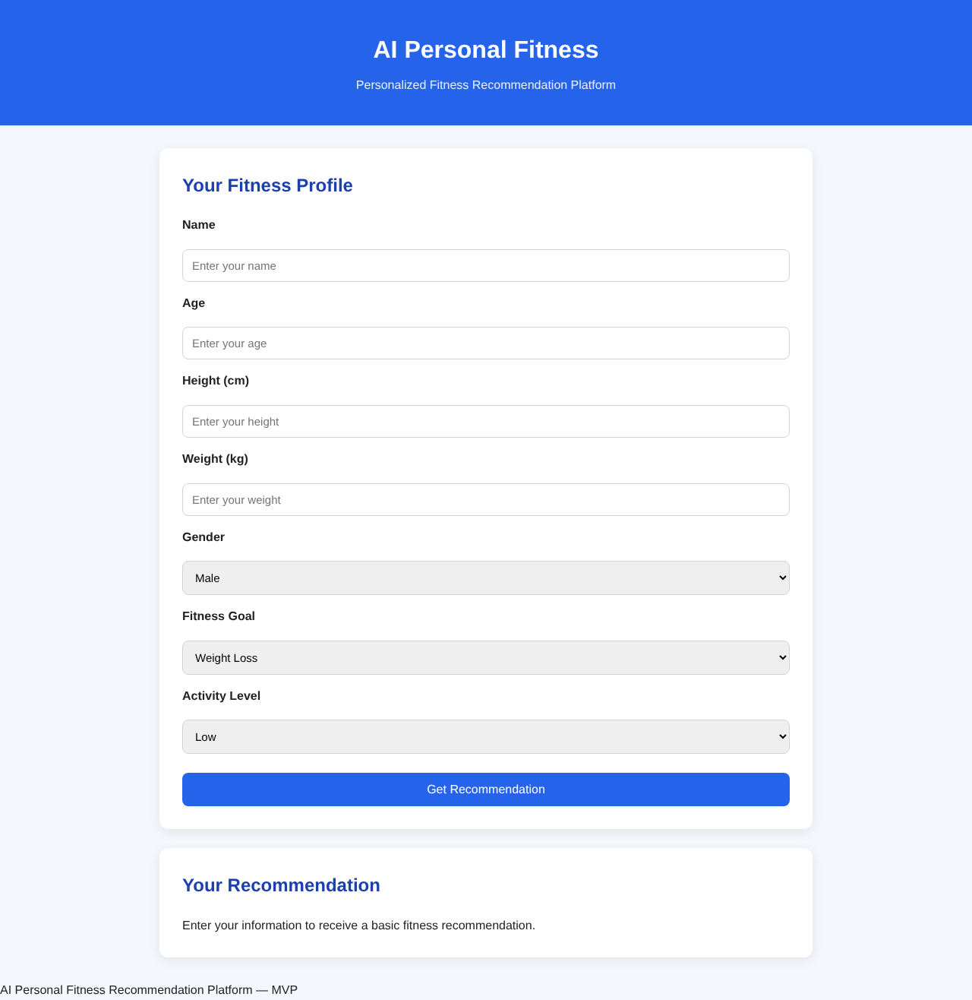
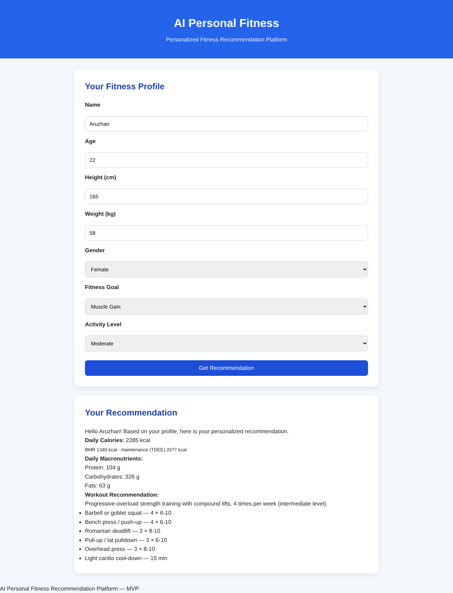
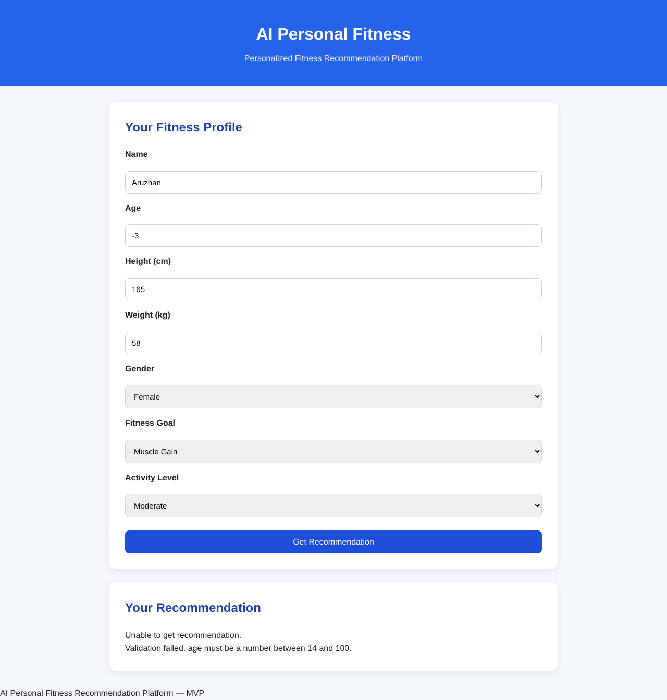
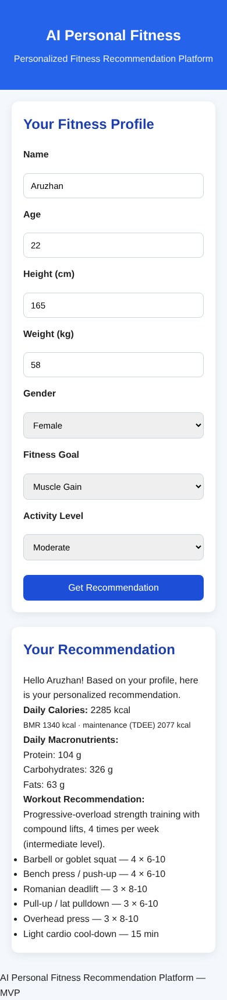

# 8. UX and Prototype

## 8.1 Working prototype

The prototype is the running application in this repository. Start it with:

```bash
cd backend
cp .env.example .env      # then set JWT_SECRET
npm install
npm start                 # opens on http://localhost:3000
```

The screenshots below were taken from this build on 24 October 2026.

## 8.2 Key user scenario: guest gets a recommendation (UC-03 → UC-06 → UC-07)

| Step | User action | System response |
|---|---|---|
| 1 | Opens the site | The profile form is shown |
| 2 | Enters name, age, height, weight; chooses sex, goal, activity level | Form fields with units; dropdowns limit the choices to valid values |
| 3 | Clicks **Get Recommendation** | The frontend sends `POST /api/recommendation` |
| 4 | — | Shows daily calories, BMR and TDEE (explainability, NFR-12), macros in grams, workout summary and list of exercises |
| 4a | (invalid input) | Shows "Unable to get recommendation" plus the exact validation message; nothing is calculated |

**Screen 1: profile form**



**Screen 2: recommendation result** (female, 22 y, 165 cm, 58 kg, muscle gain, moderate activity)



**Screen 3: validation error** (age = −3)



**Screen 4: mobile layout, 390 px** (NFR-03)



## 8.3 Planned screens (registered user, pre-defense 2)

| Screen | Content | Requirements |
|---|---|---|
| Sign up / Log in | Email, password (≥ 8 chars), name; error messages; link between the two forms | FR-01, FR-02 |
| Profile | Same fields as the guest form plus workout preference (home/gym); **Save** button | FR-03 |
| Dashboard | Cards: *My profile*, *Today's targets* (calories, BMR, TDEE, macros), *My workout plan*, *History* (date, goal, calories), and a **Generate new recommendation** button; disclaimer footer | FR-10, FR-11, FR-14 |

Wireframe of the dashboard:

```
┌──────────────────────────────────────────────────────────────┐
│ AI Personal Fitness                    Hello, Aruzhan  [Log out]│
├───────────────────────┬──────────────────────────────────────┤
│ MY PROFILE            │ TODAY'S TARGETS                      │
│ 22 y · F · 165 cm     │ 2285 kcal   (BMR 1340 · TDEE 2077)   │
│ 58 kg · Moderate      │ Protein 104 g · Fat 63 g · Carbs 326 g│
│ Goal: Muscle gain     │                                      │
│ [Edit profile]        │ [Generate new recommendation]        │
├───────────────────────┴──────────────────────────────────────┤
│ MY WORKOUT PLAN  · 4 sessions / week · intermediate          │
│ • Goblet squat 4×6-10  • Bench press 4×6-10  • RDL 3×8-10 ... │
├──────────────────────────────────────────────────────────────┤
│ HISTORY                                                      │
│ 24.10.2026  Muscle gain   2285 kcal                          │
│ 10.10.2026  Maintenance   2077 kcal                          │
├──────────────────────────────────────────────────────────────┤
│ ⚠ Recommendations are approximate and do not replace advice  │
│   from a doctor or dietitian.                                │
└──────────────────────────────────────────────────────────────┘
```

## 8.4 API examples (input and output)

**Guest recommendation: request**

```bash
curl -X POST http://localhost:3000/api/recommendation \
  -H "Content-Type: application/json" \
  -d '{"name":"Daniyar","age":25,"height":178,"weight":90,"gender":"male","goal":"weight-loss","activity":"low"}'
```

**Response `200 OK`** (abridged; full file: [`prototype/api-example-response.json`](prototype/api-example-response.json))

```json
{
  "name": "Daniyar",
  "goal": "weight-loss",
  "activity": "low",
  "bmr": 1893,
  "tdee": 2271,
  "calories": 1930,
  "macronutrients": { "protein": 162, "carbohydrates": 199, "fats": 54 },
  "workout": {
    "level": "beginner",
    "sessions_per_week": 3,
    "summary": "Full-body strength circuits combined with moderate-intensity cardio, 3 times per week (beginner level).",
    "exercises": [
      { "exercise_name": "Bodyweight squat", "workout_type": "strength", "sets": 3, "repetitions": "12-15" },
      { "exercise_name": "Brisk walking / cycling", "workout_type": "cardio", "duration_minutes": 30 }
    ]
  }
}
```

**Invalid input: response `400 Bad Request`**

```json
{
  "error": "Validation failed.",
  "details": [
    "age must be a number between 14 and 100.",
    "goal must be one of: weight-loss, muscle-gain, maintenance."
  ]
}
```

**Registered flow**

```bash
# 1. Register → token
curl -X POST localhost:3000/api/auth/register -H "Content-Type: application/json" \
  -d '{"email":"student@example.com","password":"secret-pass-1","name":"Student"}'
# 2. Save profile
curl -X PUT localhost:3000/api/profile -H "Authorization: Bearer <token>" -H "Content-Type: application/json" \
  -d '{"name":"Student","age":22,"height":165,"weight":58,"gender":"female","goal":"maintenance","activity":"moderate","workoutPreference":"home"}'
# 3. Generate and store a recommendation → 201
curl -X POST localhost:3000/api/recommendations -H "Authorization: Bearer <token>"
# 4. History
curl localhost:3000/api/recommendations -H "Authorization: Bearer <token>"
```

## 8.5 UX principles applied

- **Show the reasoning:** BMR and TDEE are displayed next to the target, which supports user trust (A2) and follows the transparency gap identified in [1, 4].
- **Prevent errors early:** dropdowns for enumerated fields and numeric inputs with units; the server re-validates (FR-05).
- **Specific error messages** that name the field and the allowed range.
- **One screen, one task** for the guest flow; the dashboard groups everything for returning users. Goal setting and feedback are among the most effective behaviour-change strategies [9].
